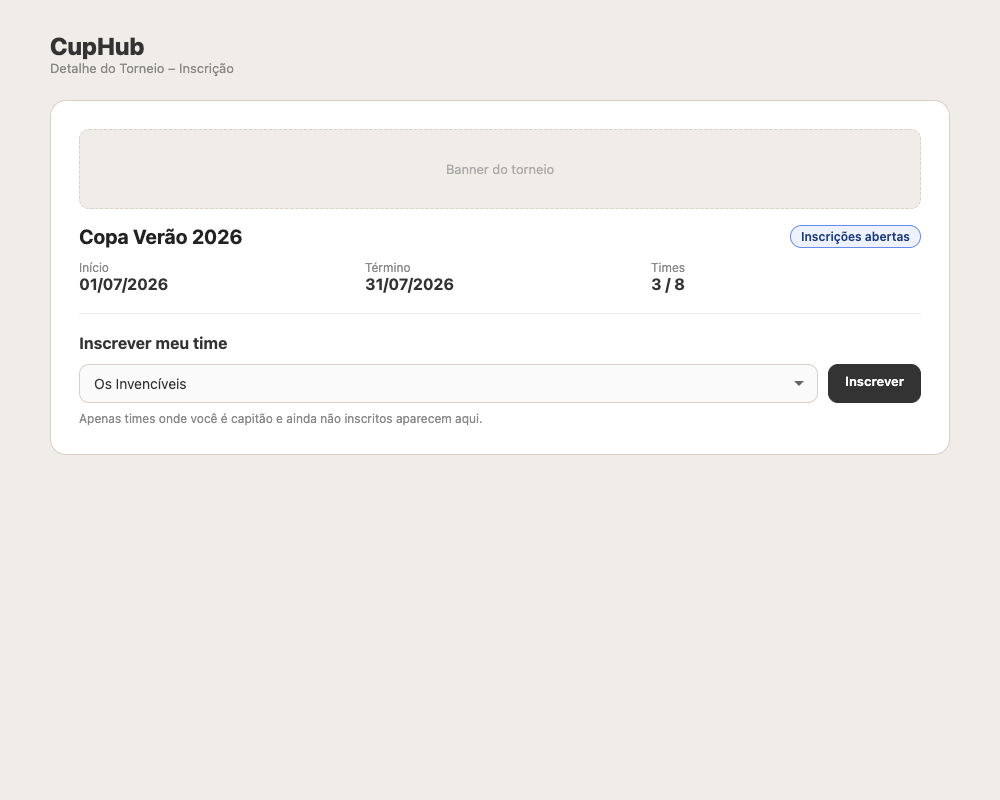
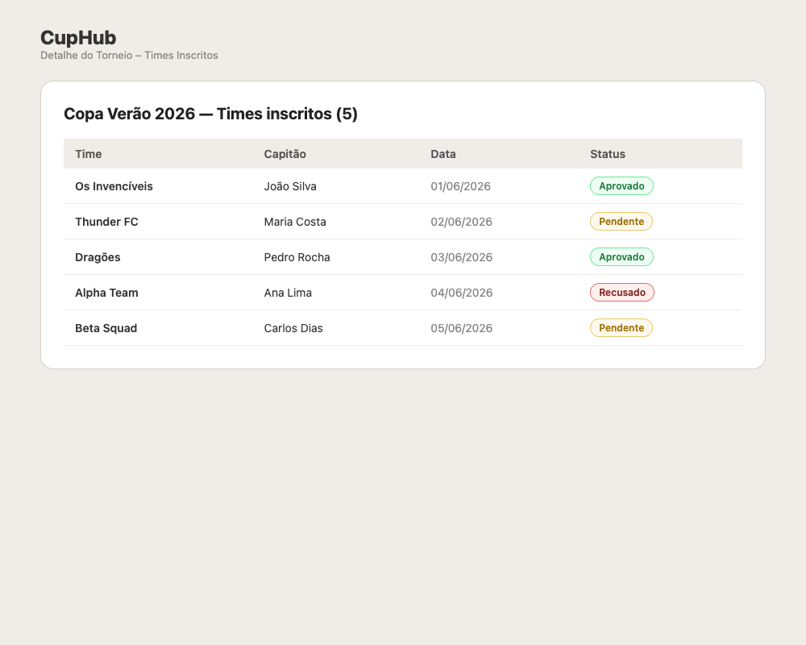
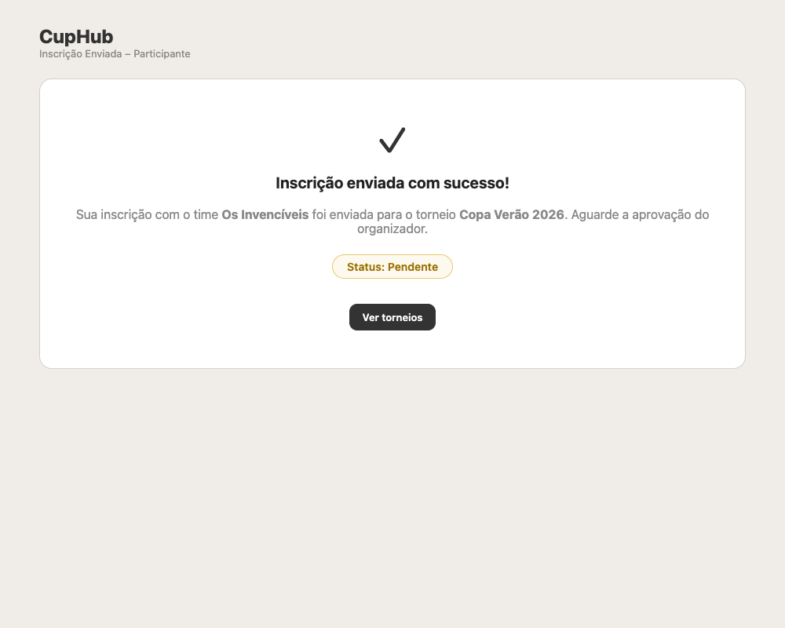
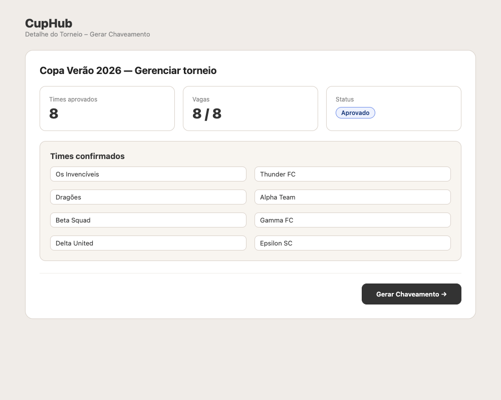
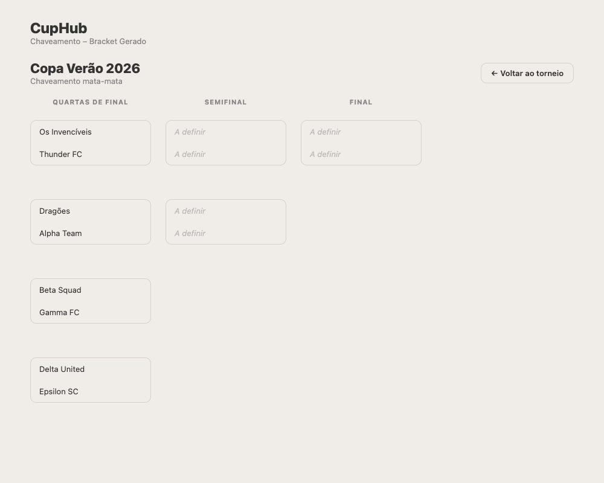
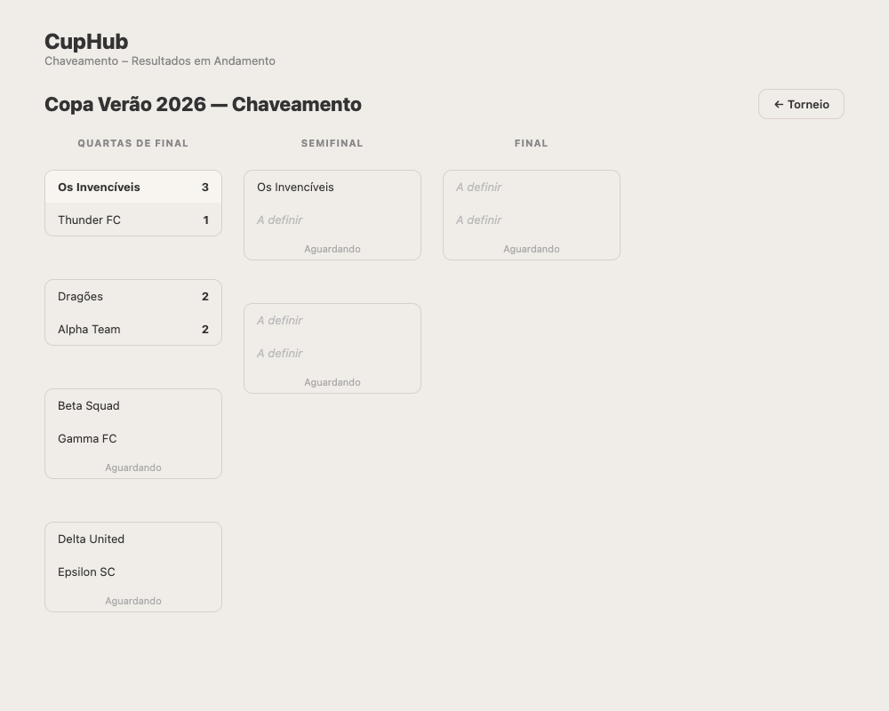
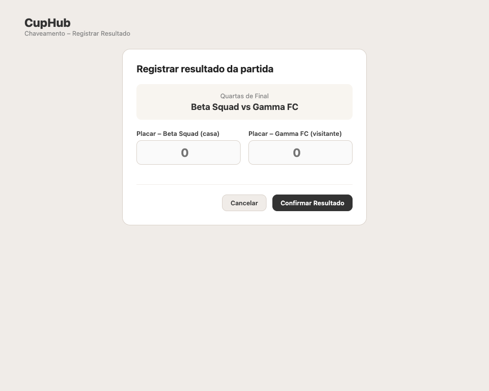
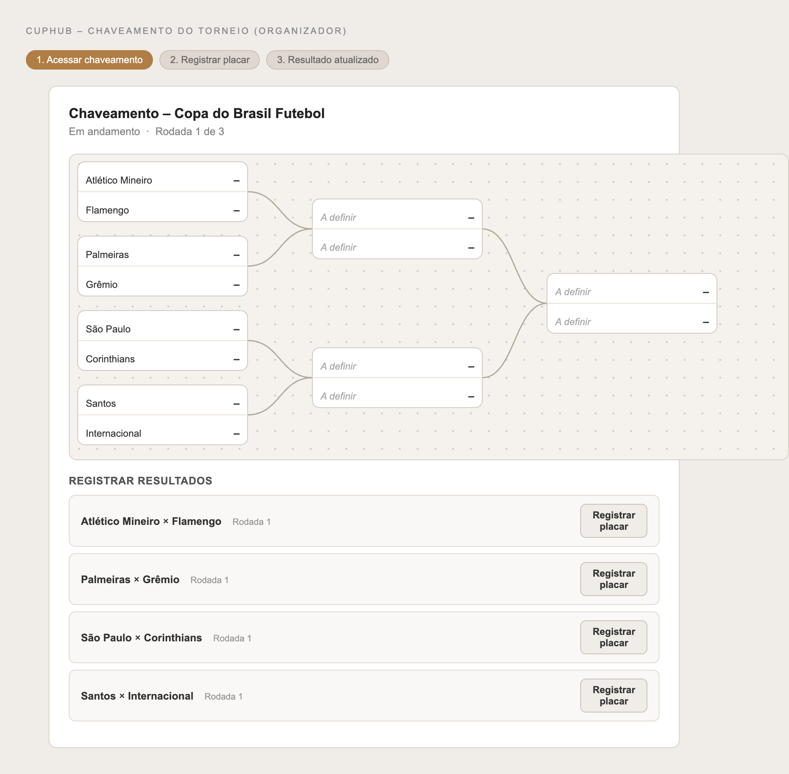
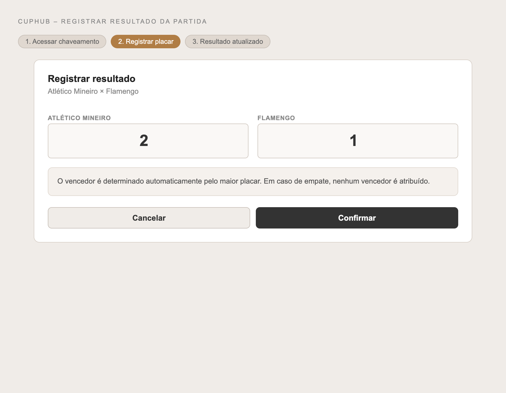
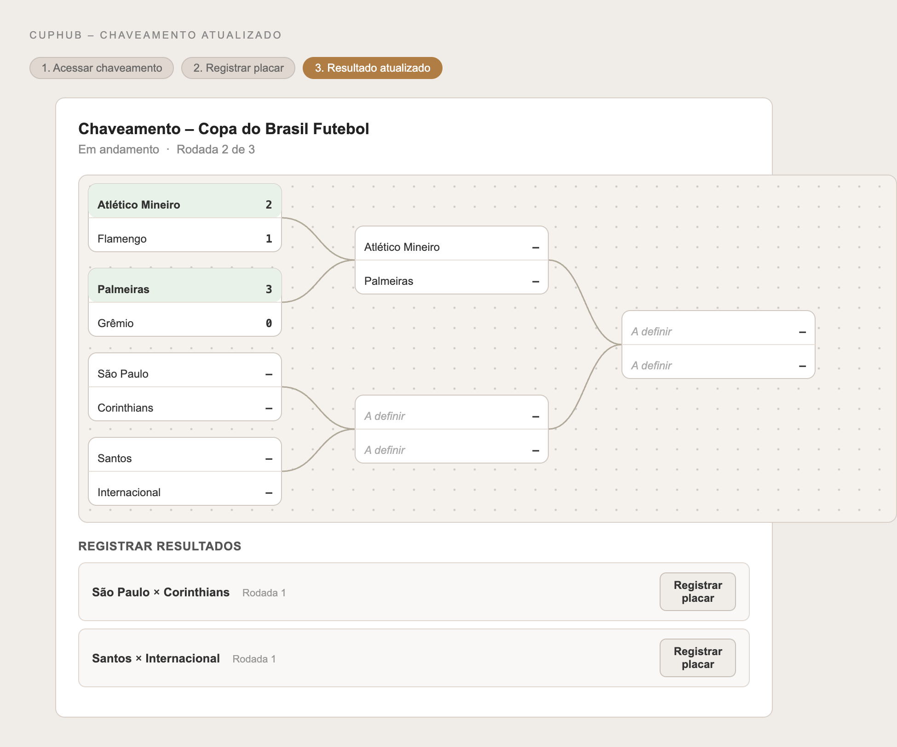

## 6. Interface do sistema

_Visão geral da interação do usuário por meio das telas do sistema. Apresente as principais interfaces da plataforma._

## 6.1. Tela principal do sistema

_Descrição da tela principal do sistema._

Tela principal do sistema

## 6.2. Telas do processo 1

TELA 1:

Dashboard
Tela inicial do sistema, onde o usuário visualiza seus torneios cadastrados e pode criar um novo torneio clicando em "+ Novo Torneio".   

TELA 2:

Novo Torneio: Dados Básicos
Formulário de cadastro das informações iniciais do torneio, como nome, data de início, local, descrição, categoria e número de equipes.

TELA 3:

Novo Torneio: Regras 
Configuração das regras do torneio, incluindo o formato (Eliminação Simples, Dupla, Round-Robin ou Misto), pontuação por resultado e duração das partidas.

TELA 4:

Novo Torneio: Revisar
Tela de revisão que exibe um resumo de todas as informações preenchidas antes da confirmação final.

TELA 5:

Novo Torneio: Confirmar 
Etapa final de confirmação, onde o usuário valida as informações por meio de checkboxes e cria o torneio clicando em "Confirmar e Salvar".

## 6.3. Telas do processo 2

TELA 1:

Inscrição de Time: Dados
Formulário de cadastro das informações da equipe, como nome do time, dados do capitão e lista de membros participantes.

TELA 2:

Inscrição de Time: Validação
Etapa de processamento onde o sistema realiza a validação automática dos dados e campos obrigatórios preenchidos pelo capitão.

TELA 3:

Analisar Inscrição
Tela de revisão que exibe os detalhes da solicitação de inscrição e permite ao organizador aprovar ou recusar o time com observações.

## 6.4. Telas do processo 3

TELA 1:

Solicitar Chaveamento
Tela com seleção do torneio e botão para avançar.

TELA 2:

Verificar as Equipes
Tela que lista automaticamente as equipes inscritas no torneio selecionado.

TELA 1:

Realizar Sorteio das Duplas
Tela com botão "Sortear agora" para distribuir as equipes nas chaves.

TELA 1:

Chaveamento Final
Tela com a tabela de confrontos gerada e opção de divulgar os resultados.

## 6.4. Telas do processo 4

TELA 1:

Execução de Partidas
Formulário de coleta dos nomes das equipes e o horário da partida.

TELA 2:

Registro de Resultados
Formulário de coleta do resultado da partida.

TELA 1:

Divulgação de Resultados
Etapa de divulgação dos resultados.
