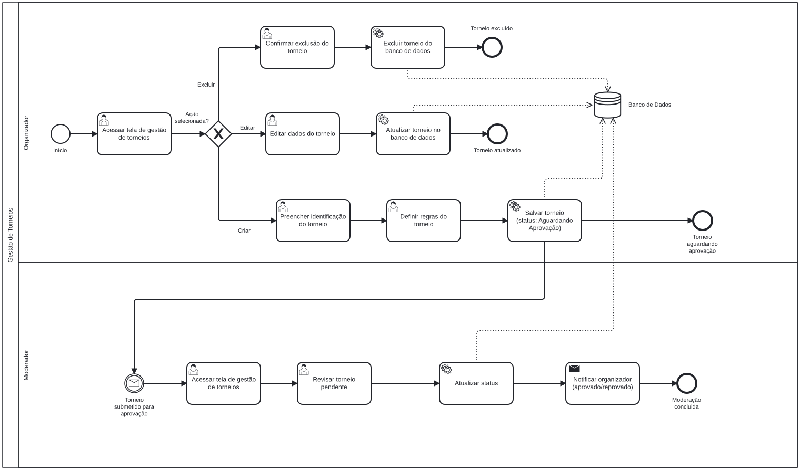
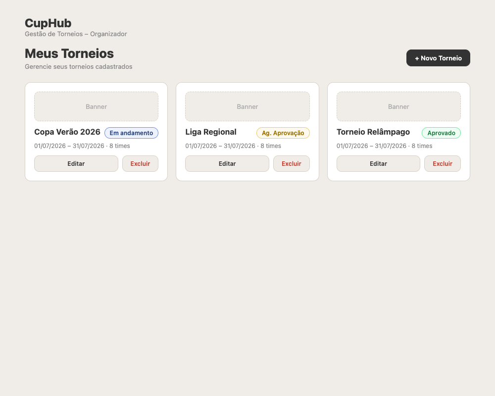
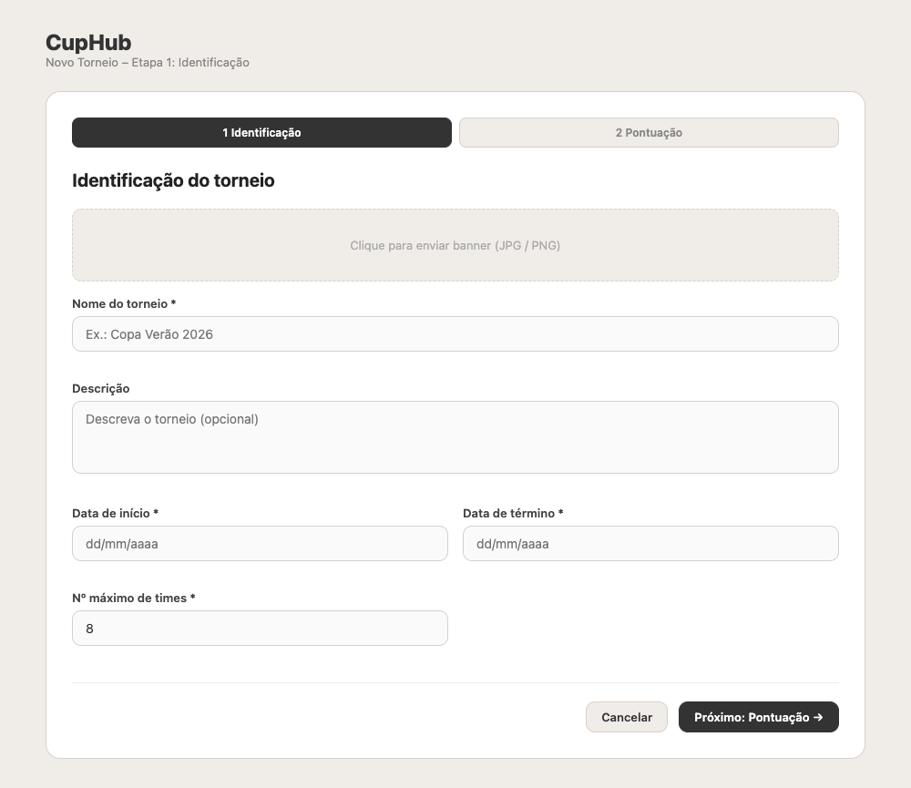
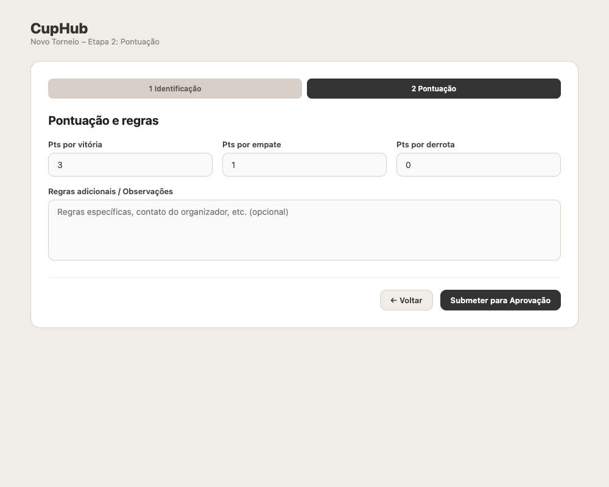
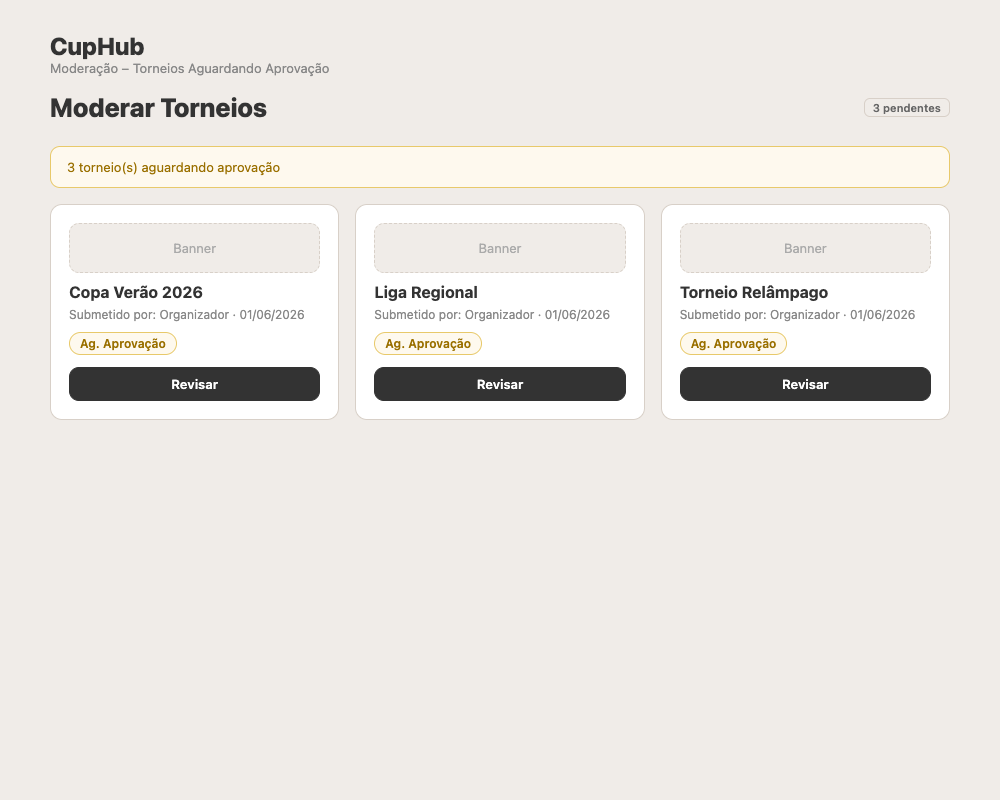
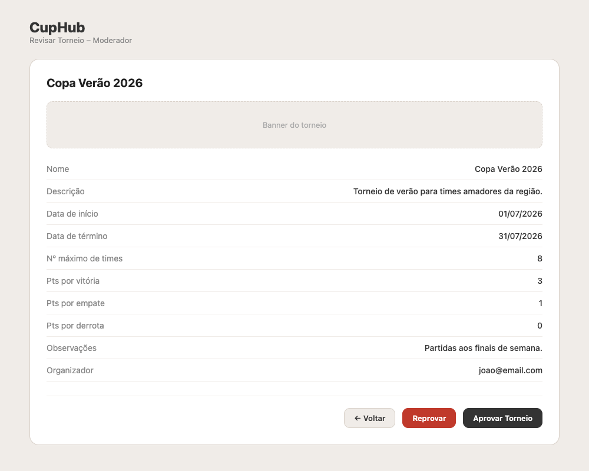

### 3.3.1 Processo 1 – Gestão de Torneios

O processo de gestão de torneios é executado por dois atores: o **Organizador** e o **Moderador**. O Organizador acessa a tela de torneios (`/torneios`) para visualizar todos os torneios disponíveis, ou a tela de seus torneios (`/meus-torneios`) para gerenciar os que criou. A criação é feita via wizard de 2 etapas na `/torneios`.

No fluxo de **criação**, o Organizador preenche os dados de identificação do torneio (banner, nome, descrição, datas e número máximo de times) na etapa 1, e configura a pontuação (pontos por vitória, empate e derrota) além de observações gerais na etapa 2. Ao concluir, o sistema persiste o torneio com o status **pending_approval** via `POST /api/tournaments` e sinaliza aos moderadores.

No fluxo de **edição**, o Organizador seleciona um torneio existente e altera seus dados via `PUT /api/tournaments/{id}`. No fluxo de **exclusão**, o Organizador confirma a remoção e o sistema exclui o registro via `DELETE /api/tournaments/{id}`.

Do lado do **Moderador**, ele acessa `/moderador/torneios` filtrando por torneios pendentes e clica em "Revisar" para analisar os detalhes em `/moderador/torneios/:id`. O Moderador então aprova ou reprova o torneio via `PATCH /api/tournaments/{id}/status`, que atualiza o status para `approved` ou `rejected` e notifica o Organizador.

**1) Acessar tela de gestão de torneios (Organizador)**

| **Campo**         | **Tipo**       | **Restrições**  | **Valor default**              |
| ----------------- | -------------- | --------------- | ------------------------------ |
| Lista de torneios | Cards          | Somente leitura | Torneios do organizador logado |
| Filtro de status  | Select / Tabs  | Opcional        | Todos                          |

| **Comando**    | **Destino**                        | **Tipo** |
| -------------- | ---------------------------------- | -------- |
| + Novo Torneio | Preencher identificação do torneio | default  |
| Editar         | Editar dados do torneio            | default  |
| Excluir        | Confirmar exclusão do torneio      | default  |

---

**2) Preencher identificação do torneio**

| **Campo**          | **Tipo**         | **Restrições**                   | **Valor default** |
| ------------------ | ---------------- | -------------------------------- | ----------------- |
| Banner             | URL da imagem    | Opcional; URL pública de imagem  | null              |
| Nome do torneio    | Caixa de texto   | Mínimo 3 caracteres; obrigatório | null              |
| Descrição          | Área de texto    | Opcional                         | null              |
| Data de início     | Data             | Obrigatório                      | Data atual        |
| Data de término    | Data             | Obrigatório; ≥ data de início    | Data atual        |
| Nº máximo de times | Número           | Obrigatório; ≥ 4                 | 4                 |

| **Comando**          | **Destino**                  | **Tipo** |
| -------------------- | ---------------------------- | -------- |
| Próximo: Pontuação → | Definir pontuação do torneio | default  |
| Cancelar             | Tela de gestão de torneios   | cancel   |

---

**3) Definir pontuação do torneio**

| **Campo**            | **Tipo** | **Restrições** | **Valor default** |
| -------------------- | -------- | -------------- | ----------------- |
| Pontos por vitória   | Número   | ≥ 0            | 3                 |
| Pontos por empate    | Número   | ≥ 0            | 1                 |
| Pontos por derrota   | Número   | ≥ 0            | 0                 |
| Observações / Regras | Texto    | Opcional       | null              |

| **Comando**             | **Destino**                        | **Tipo** |
| ----------------------- | ---------------------------------- | -------- |
| Submeter para Aprovação | Salvar torneio (pending_approval)  | default  |
| ← Voltar                | Preencher identificação do torneio | cancel   |

---

**4) Editar dados do torneio**

> **Nota:** A edição e exclusão de torneios são acessadas através da tela `/meus-torneios`, onde o organizador clica em "Gerenciar torneio" para acessar o detalhe do torneio (`/torneios/:id`). A edição e exclusão são realizadas na tela de detalhe do torneio.

| **Campo**          | **Tipo**         | **Restrições**                   | **Valor default** |
| ------------------ | ---------------- | -------------------------------- | ----------------- |
| Banner             | Upload de imagem | Opcional                         | Banner atual      |
| Nome do torneio    | Caixa de texto   | Mínimo 3 caracteres; obrigatório | Dado do banco     |
| Descrição          | Área de texto    | Opcional                         | Dado do banco     |
| Data de início     | Data             | Obrigatório                      | Dado do banco     |
| Data de término    | Data             | Obrigatório; ≥ data de início    | Dado do banco     |
| Nº máximo de times | Número           | Obrigatório; ≥ 2                 | Dado do banco     |

| **Comando** | **Destino**                | **Tipo** |
| ----------- | -------------------------- | -------- |
| Salvar      | Atualizar torneio          | default  |
| Cancelar    | Tela de gestão de torneios | cancel   |

---

**5) Confirmar exclusão do torneio**

| **Campo**       | **Tipo** | **Restrições**  | **Valor default** |
| --------------- | -------- | --------------- | ----------------- |
| Nome do torneio | Texto    | Somente leitura | Dado do banco     |

| **Comando** | **Destino**                | **Tipo** |
| ----------- | -------------------------- | -------- |
| Confirmar   | Excluir torneio            | default  |
| Cancelar    | Tela de gestão de torneios | cancel   |

---

**6) Acessar tela de gestão de torneios (Moderador)**

| **Campo**         | **Tipo**       | **Restrições**  | **Valor default**              |
| ----------------- | -------------- | --------------- | ------------------------------ |
| Lista de torneios | Cards          | Somente leitura | Torneios pendentes em destaque |
| Filtro de status  | Select / Tabs  | Opcional        | pending_approval               |

| **Comando** | **Destino**              | **Tipo** |
| ----------- | ------------------------ | -------- |
| Revisar     | Revisar torneio pendente | default  |

---

**7) Revisar torneio pendente (Moderador)**

| **Campo**          | **Tipo** | **Restrições**  | **Valor default** |
| ------------------ | -------- | --------------- | ----------------- |
| Banner             | Imagem   | Somente leitura | Dado do banco     |
| Nome do torneio    | Texto    | Somente leitura | Dado do banco     |
| Descrição          | Texto    | Somente leitura | Dado do banco     |
| Data de início     | Texto    | Somente leitura | Dado do banco     |
| Data de término    | Texto    | Somente leitura | Dado do banco     |
| Nº máximo de times | Texto    | Somente leitura | Dado do banco     |
| Pontos por vitória | Texto    | Somente leitura | Dado do banco     |
| Pontos por empate  | Texto    | Somente leitura | Dado do banco     |
| Pontos por derrota | Texto    | Somente leitura | Dado do banco     |
| Observações        | Texto    | Somente leitura | Dado do banco     |
| Organizador        | Texto    | Somente leitura | Dado do banco     |

Ao clicar em "Reprovar", abre-se um modal com campo opcional de **motivo da reprovação** (textarea).

| **Comando**     | **Destino**                              | **Tipo** |
| --------------- | ---------------------------------------- | -------- |
| Aprovar Torneio | Atualizar status para approved           | default  |
| Reprovar        | Abrir modal de motivo (opcional) e atualizar status para rejected | cancel   |
| ← Voltar        | Tela de gestão de torneios (Moderador)   | cancel   |

---

#### Wireframes

> **Nota:** Os wireframes abaixo representam a versão de design. A implementação real difere em alguns pontos (banner via URL ao invés de upload, mínimo de 4 times ao invés de 2, default de 4 times ao invés de 8, e ausência de botões de editar/excluir direto nos cards). A implementação é a fonte da verdade.

| # | Tela | Descrição |
|---|------|-----------|
| 1 |  | **Tela de Gestão de Torneios (Organizador):** Listagem em cards dos torneios do organizador com banner, nome, status e botões de editar/excluir. Botão "+ Novo Torneio" no cabeçalho. |
| 2 |  | **Modal Wizard – Etapa 1 – Identificação:** Formulário com campo de URL de banner (na implementação é text input, não upload), nome, descrição, datas e número máximo de times (mínimo 4, default 4). Indicador de progresso no topo. |
| 3 |  | **Modal Wizard – Etapa 2 – Pontuação:** Configuração de pontos por vitória, empate e derrota, mais campo de observações. Botão "Submeter para Aprovação" ao concluir. |
| 4 |  | **Tela de Moderação (Moderador):** Listagem de torneios aguardando aprovação com filtros (Aguardando/Aprovados/Todos) e botão "Revisar" em cada card pendente. Na implementação, a contagem é exibida no título sem banner de alerta. |
| 5 |  | **Revisar Torneio Pendente (Moderador):** Tela de detalhe com todos os dados em somente leitura, incluindo organizador. Ações "Aprovar Torneio" e "Reprovar" no rodapé. Ao clicar em Reprovar, abre-se modal com campo opcional de motivo. |
