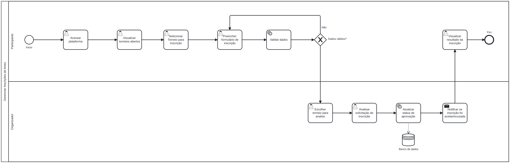
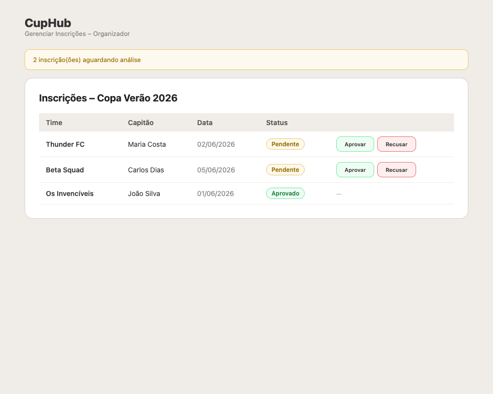
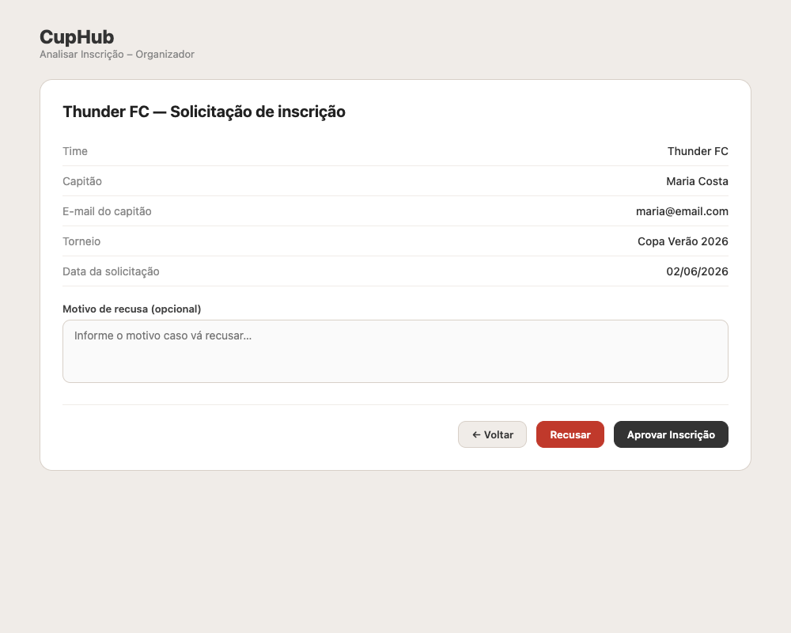

### 3.3.2 Processo 2 – Gerenciar Inscrições de Times

O gerenciamento das inscrições acontece dentro da plataforma e é focado na interação entre o **Participante** (capitão de um time) e o **Organizador** do torneio. O processo inicia quando o participante acessa o detalhe de um torneio com inscrições abertas (`/torneios/:id`).

Na tela de detalhe, o participante seleciona um dos times que ele capitaneia e que ainda não foi inscrito no torneio. Ao clicar em "Inscrever", o sistema envia a inscrição via `POST /api/tournaments/{id}/registrations` com status **pending**. Apenas times onde o usuário logado é capitão aparecem na seleção.

O Organizador acessa a lista de inscrições do seu torneio e analisa cada solicitação pendente. Ele pode aprovar ou recusar a inscrição via `PATCH /api/registrations/{id}/review`, informando opcionalmente o motivo em caso de recusa. O sistema persiste a decisão e o participante pode consultar o status atualizado na tela de detalhe do torneio.

**1) Acessar detalhe do torneio (Participante)**

| **Campo**                  | **Tipo**       | **Restrições**  | **Valor default**                      |
| -------------------------- | -------------- | --------------- | -------------------------------------- |
| Nome do torneio            | Texto          | Somente leitura | Dado do banco                          |
| Status                     | Badge          | Somente leitura | Dado do banco                          |
| Datas e nº de times        | Texto          | Somente leitura | Dado do banco                          |
| Times inscritos (lista)    | Tabela         | Somente leitura | Inscrições do torneio                  |
| Seleção de time (inscrição)| Select         | Apenas capitão  | Times do usuário não inscritos         |

| **Comando**  | **Destino**                    | **Tipo** |
| ------------ | ------------------------------ | -------- |
| Inscrever    | Validar e enviar inscrição     | default  |
| Ver chaveamento | Visualizar bracket          | default  |

---

**2) Validação e resultado da inscrição**

| **Campo**        | **Tipo** | **Restrições**  | **Valor default** |
| ---------------- | -------- | --------------- | ----------------- |
| Mensagem de erro | Texto    | Somente leitura | null              |
| Mensagem de sucesso | Texto | Somente leitura | null              |

| **Comando**   | **Destino**             | **Tipo** |
| ------------- | ----------------------- | -------- |
| Ver torneios  | Lista de torneios abertos | default |

---

**3) Analisar solicitação de inscrição (Organizador)**

| **Campo**         | **Tipo**       | **Restrições**                | **Valor default** |
| ----------------- | -------------- | ----------------------------- | ----------------- |
| Nome do time      | Texto          | Somente leitura               | Dado do banco     |
| Nome do capitão   | Texto          | Somente leitura               | Dado do banco     |
| E-mail do capitão | Texto          | Somente leitura               | Dado do banco     |
| Data da solicitação | Texto        | Somente leitura               | Dado do banco     |
| Motivo de recusa  | Área de texto  | Opcional                       | null              |

| **Comando**        | **Destino**                  | **Tipo** |
| ------------------ | ---------------------------- | -------- |
| Aprovar Inscrição  | Atualizar status (approved)  | default  |
| Recusar            | Atualizar status (rejected)  | cancel   |
| ← Voltar           | Lista de inscrições          | cancel   |

---

**4) Lista de inscrições (Organizador)**

| **Campo**               | **Tipo**       | **Restrições** | **Valor default**                 |
| ----------------------- | -------------- | -------------- | --------------------------------- |
| Seleção de torneio      | Select         | Obrigatório    | Torneio mais recente              |
| Lista de inscrições     | Tabela         | Somente leitura| Inscrições do torneio selecionado |
| Filtro de status        | Select / Tabs  | Opcional       | Pendentes                         |

| **Comando** | **Destino**                       | **Tipo** |
| ----------- | --------------------------------- | -------- |
| Analisar    | Analisar solicitação de inscrição | default  |

---

#### Wireframes

| # | Tela | Descrição |
|---|------|-----------|
| 1 |  | **Detalhe do Torneio (Participante):** Informações do torneio com select de time para inscrição. Exibe apenas times onde o usuário é capitão e ainda não estão inscritos. |
| 2 |  | **Times Inscritos:** Tabela com todos os times inscritos, mostrando nome, capitão, data e badge de status (Aprovado / Pendente / Recusado). |
| 3 |  | **Inscrição Enviada:** Tela de confirmação informando que a inscrição foi enviada e está aguardando aprovação do organizador. |
| 4 |  | **Gerenciar Inscrições (Organizador):** Tabela de inscrições pendentes com alerta de quantidade e botões individuais de aprovar/recusar por linha. |
| 5 |  | **Analisar Inscrição (Organizador):** Detalhe da inscrição em somente leitura, campo de motivo de recusa opcional, e botões "Aprovar" e "Recusar" no rodapé. |
