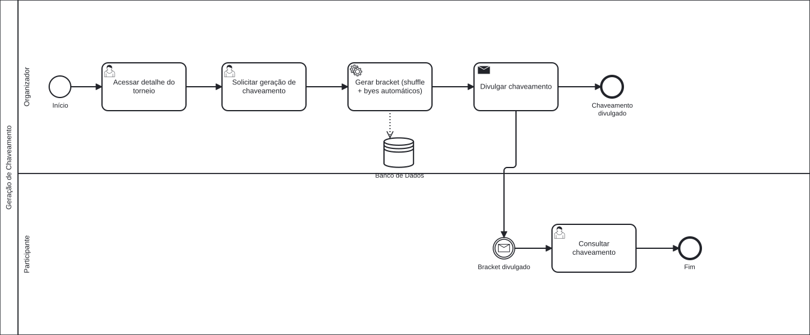

### 3.3.3 Processo 3 – Geração de Chaveamento

O processo de geração de chaveamento é executado pelo **Organizador** do torneio e resulta em um bracket mata-mata visível a todos os **Participantes**. O processo tem início quando o organizador, com os times aprovados confirmados, acessa o detalhe do torneio e solicita a geração do chaveamento via `POST /api/tournaments/{id}/bracket/generate`.

O sistema realiza automaticamente a validação do número de equipes aprovadas (mínimo 2), embaralha os times aleatoriamente (shuffle) e cria as partidas da primeira rodada. Quando o número de times não é potência de 2, posições "bye" são adicionadas automaticamente para equilibrar o bracket. As partidas das rodadas seguintes (semifinal, final) também são criadas como slots vazios, que serão preenchidos conforme os vencedores avançam. O status do torneio é atualizado para **in_progress**.

**Endpoints da API envolvidos:**

| Ação | Método | Endpoint |
|------|--------|----------|
| Gerar chaveamento | `POST` | `/api/tournaments/{id}/bracket/generate` |
| Consultar partidas | `GET` | `/api/tournaments/{id}/matches` |
| Registrar resultado | `PATCH` | `/api/matches/{matchId}/result` |

Após a geração, o chaveamento fica disponível na tela do torneio (`/torneios/:id/chaveamento`), onde os Participantes podem consultar os confrontos, os placares das partidas finalizadas e o avanço do bracket.

**1) Acessar detalhe do torneio (Organizador)**

| **Campo**               | **Tipo**      | **Restrições**  | **Valor default**              |
| ----------------------- | ------------- | --------------- | ------------------------------ |
| Times inscritos (lista) | Cards / Lista | Somente leitura | Times com inscrição approved   |
| Total de times          | Número        | Somente leitura | Contagem automática            |
| Status do torneio       | Badge         | Somente leitura | Dado do banco                  |

| **Comando**         | **Destino**                    | **Tipo** |
| ------------------- | ------------------------------ | -------- |
| Gerar Chaveamento → | Solicitar geração de chaveamento | default |
| Cancelar            | Tela do torneio                | cancel   |

---

**2) Consultar chaveamento (Participante)**

| **Campo**           | **Tipo**     | **Restrições**  | **Valor default**         |
| ------------------- | ------------ | --------------- | ------------------------- |
| Bracket / confrontos| Visualização | Somente leitura | Resultado do shuffle      |
| Placar              | Texto        | Somente leitura | Preenchido após resultado |
| Fases seguintes     | Texto        | Somente leitura | "A definir"               |

| **Comando**  | **Destino**        | **Tipo** |
| ------------ | ------------------ | -------- |
| ← Torneio    | Detalhe do torneio | cancel   |

---

#### Wireframes

| # | Tela | Descrição |
|---|------|-----------|
| 1 |  | **Detalhe do Torneio (Organizador):** Painel com métricas de times aprovados, vagas e status, lista de times confirmados e botão "Gerar Chaveamento" disponível quando o torneio está aprovado. |
| 2 |  | **Bracket Gerado:** Visualização do chaveamento mata-mata com confrontos da 1ª rodada definidos e fases seguintes (Semifinal / Final) exibidas como "A definir". |
| 3 |  | **Bracket em Andamento:** Bracket atualizado com resultados de partidas finalizadas e vencedor destacado, enquanto partidas pendentes mostram "Aguardando". |
| 4 |  | **Registrar Resultado:** Formulário com placares da casa e visitante. O sistema calcula o vencedor automaticamente com base no maior placar. |
