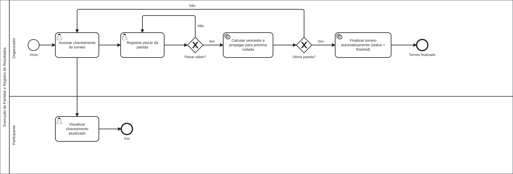

### 3.3.4 Processo 4 – Execução das Partidas e Registro de Resultados

O processo de execução de partidas e registro de resultados é gerenciado pelo **Organizador** do torneio. O fluxo tem início quando o organizador acessa o chaveamento do torneio (`/torneios/:id/chaveamento`), onde visualiza o bracket completo e a lista de partidas com status **scheduled** que ainda aguardam resultado.

O organizador seleciona uma partida da lista e registra o placar das duas equipes por meio de um modal. Antes de confirmar, pode corrigir os valores caso tenha cometido um erro. Quando o placar está correto, o organizador confirma e o sistema envia `PATCH /api/matches/{id}/result` com `homeScore` e `awayScore`. O backend determina automaticamente o vencedor (maior placar), atualiza o status da partida para **finished** e propaga o vencedor para o slot correspondente na próxima rodada (`ceil(posição / 2)`, home se posição ímpar, away se par).

Caso ainda haja partidas pendentes, o processo se repete. Quando não existe próxima rodada para o vencedor ser propagado, o sistema identifica que a partida final foi concluída e atualiza o status do torneio para **finished** automaticamente. Os **Participantes** podem acompanhar o chaveamento atualizado a qualquer momento na mesma tela.

Empates são possíveis — nesse caso nenhum vencedor é definido e a propagação não ocorre.

#### Detalhamento das atividades

_* **Acessar chaveamento do torneio** – Organizador e Participante acessam `/torneios/:id/chaveamento`, que exibe o bracket visual e a lista de partidas pendentes._

_* **Registrar placar da partida** – Organizador preenche homeScore e awayScore no modal e confirma._

_* **Calcular vencedor e propagar** (serviceTask) – Sistema determina o vencedor pelo maior placar e propaga para a próxima rodada via `PATCH /api/matches/{id}/result`._

_* **Finalizar torneio automaticamente** (serviceTask) – Sistema atualiza `tournament.status = "finished"` quando não existe próxima rodada._

_* **Visualizar chaveamento atualizado** – Participantes visualizam o resultado registrado e o bracket com os vencedores propagados._

---

**1) Acessar chaveamento do torneio (Organizador)**

| **Campo**                   | **Tipo**      | **Restrições**  | **Valor default**                                      |
| --------------------------- | ------------- | --------------- | ------------------------------------------------------ |
| Bracket visual              | Visualização  | Somente leitura | Partidas agrupadas por rodada                          |
| Lista de partidas pendentes | Lista         | Somente leitura | Partidas com `status = scheduled` e times definidos    |
| Times por partida           | Texto         | Somente leitura | homeTeamName × awayTeamName                            |
| Rodada                      | Texto         | Somente leitura | Número da rodada                                       |

| **Comando**      | **Destino**        | **Tipo** |
| ---------------- | ------------------ | -------- |
| Registrar placar | Modal de registro  | default  |
| ← Torneio        | Detalhe do torneio | cancel   |

---

**2) Registrar placar da partida (Organizador)**

| **Campo**                 | **Tipo** | **Restrições**            | **Valor default** |
| ------------------------- | -------- | ------------------------- | ----------------- |
| Placar – equipe casa      | Número   | ≥ 0; inteiro; obrigatório | null              |
| Placar – equipe visitante | Número   | ≥ 0; inteiro; obrigatório | null              |

| **Comando** | **Destino**         | **Tipo** |
| ----------- | ------------------- | -------- |
| Confirmar   | Atualizar resultado | default  |
| Cancelar    | Chaveamento         | cancel   |

---

**3) Visualizar chaveamento atualizado (Participante)**

| **Campo**          | **Tipo**     | **Restrições**  | **Valor default**                  |
| ------------------ | ------------ | --------------- | ---------------------------------- |
| Bracket            | Visualização | Somente leitura | Estado atual com vencedores        |
| Placar por partida | Texto        | Somente leitura | Exibido para partidas `finished`   |
| Vencedor propagado | Texto        | Somente leitura | Nome do time na próxima rodada     |
| Banner campeão     | Banner       | Somente leitura | Exibido quando `status = finished` |

| **Comando** | **Destino**        | **Tipo** |
| ----------- | ------------------ | -------- |
| ← Torneio   | Detalhe do torneio | cancel   |

---

#### Wireframes

| # | Tela | Descrição |
|---|------|-----------|
| 1 |  | **Etapa 1 – Chaveamento (Organizador):** Bracket visual com rounds e times. Abaixo, lista de partidas pendentes com times, rodada e botão "Registrar placar" por partida. |
| 2 |  | **Etapa 2 – Registrar Resultado (modal):** Campos numéricos de placar para casa e visitante, com aviso de que o vencedor é calculado automaticamente. Botões Cancelar e Confirmar. |
| 3 |  | **Etapa 3 – Bracket Atualizado:** Bracket exibe placares e vencedor em negrito nas partidas já finalizadas. Vencedor propagado já aparece no slot da próxima rodada. Partidas pendentes restantes continuam na lista. |
