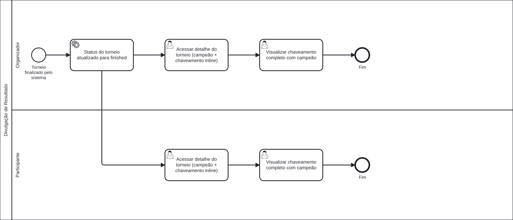
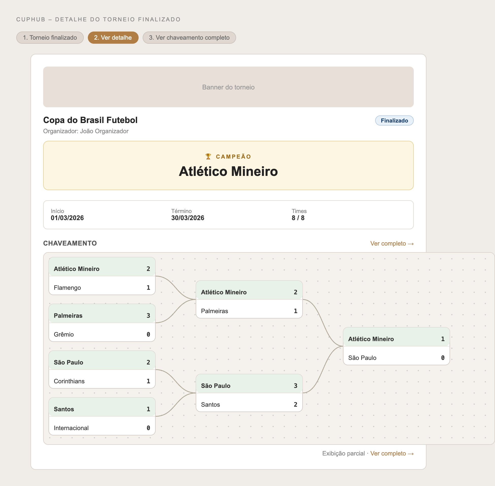
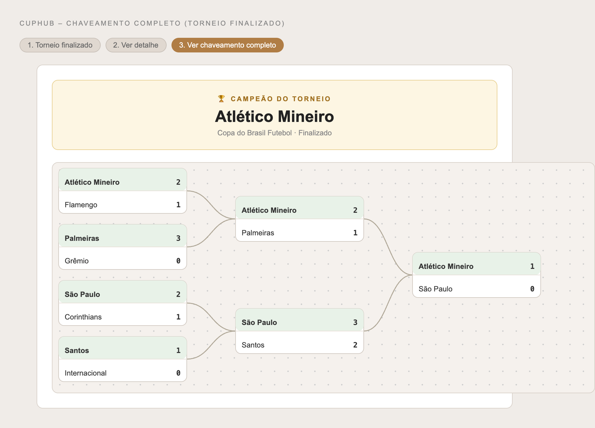

### 3.3.5 Processo 5 – Divulgação de Resultado

O processo de divulgação de resultado ocorre ao final do torneio e é iniciado automaticamente pelo sistema. Quando a última partida do bracket é registrada (Processo 4) e não existe próxima rodada para propagar o vencedor, o backend atualiza o status do torneio para **finished** sem nenhuma ação adicional do Organizador.

A partir desse momento, qualquer usuário que acessar o detalhe do torneio (`/torneios/:id`) verá o banner do campeão com destaque visual em dourado, seguido do chaveamento inline completo com todos os placares. O link "Ver completo →" leva à página de chaveamento (`/torneios/:id/chaveamento`), que também exibe o banner do campeão no topo, com o nome do torneio e a marcação "Finalizado".

Não há etapa manual de aprovação de ranking nem registro de premiação — o resultado torna-se público automaticamente ao término da última partida.

#### Detalhamento das atividades

_* **Status do torneio atualizado para finished** (serviceTask) – Sistema executa `tournament.setStatus("finished")` ao detectar que não existe próxima rodada após a última partida._

_* **Acessar detalhe do torneio** – Organizador e Participante acessam `/torneios/:id` e visualizam o banner do campeão e o chaveamento inline._

_* **Visualizar chaveamento completo com campeão** – Organizador e Participante acessam `/torneios/:id/chaveamento` e visualizam o banner do campeão no topo e o bracket completo com todos os placares._

---

**1) Acessar detalhe do torneio (Organizador / Participante)**

| **Campo**          | **Tipo**     | **Restrições**  | **Valor default**                       |
| ------------------ | ------------ | --------------- | --------------------------------------- |
| Banner do torneio  | Imagem       | Somente leitura | URL da imagem de capa                   |
| Nome do torneio    | Texto        | Somente leitura | Nome cadastrado                         |
| Status             | Badge        | Somente leitura | "Finalizado"                            |
| Banner campeão     | Destaque     | Somente leitura | Nome do time vencedor da última rodada  |
| Datas e times      | Grid         | Somente leitura | Início, término, número de times        |
| Chaveamento inline | Visualização | Somente leitura | Bracket compacto com placares           |

| **Comando**    | **Destino**           | **Tipo** |
| -------------- | --------------------- | -------- |
| Ver completo → | Chaveamento completo  | default  |

---

**2) Visualizar chaveamento completo com campeão (Organizador / Participante)**

| **Campo**        | **Tipo**     | **Restrições**  | **Valor default**                          |
| ---------------- | ------------ | --------------- | ------------------------------------------ |
| Banner campeão   | Destaque     | Somente leitura | Nome do campeão + nome do torneio          |
| Bracket completo | Visualização | Somente leitura | Todas as rodadas com placares e vencedores |

---

#### Wireframes

| # | Tela | Descrição |
|---|------|-----------|
| 1 |  | **Etapa 1 – Detalhe do Torneio:** Banner do torneio, badge "Finalizado", destaque dourado com o nome do campeão, informações gerais e chaveamento inline compacto com link "Ver completo →". |
| 2 |  | **Etapa 2 – Chaveamento Completo:** Banner dourado proeminente com "Campeão do torneio" e nome do time no topo. Bracket completo exibindo todas as rodadas, placares e vencedores em negrito. |
