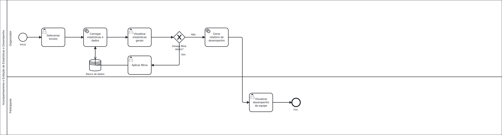
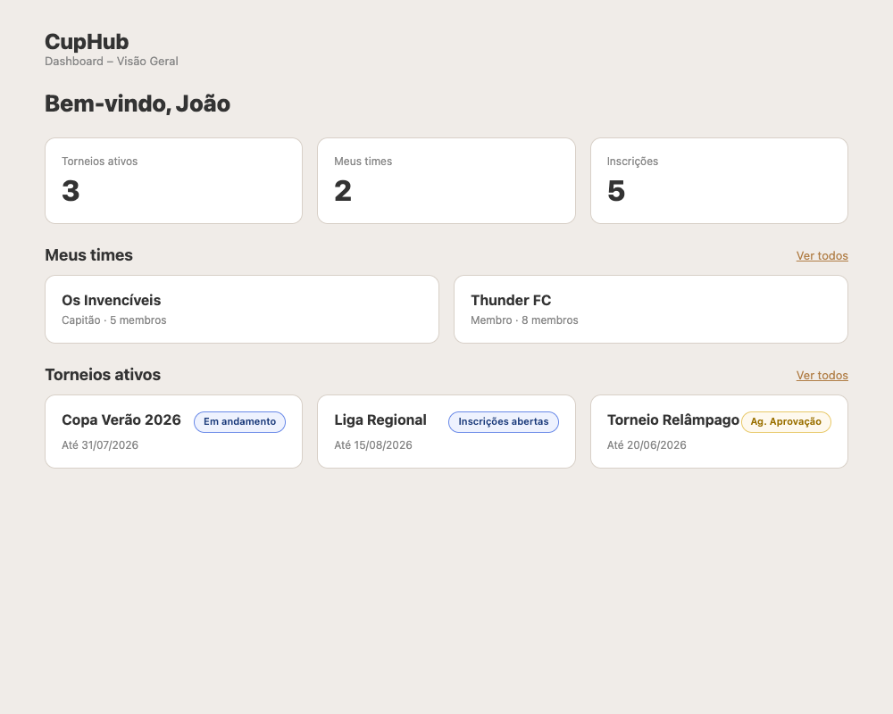
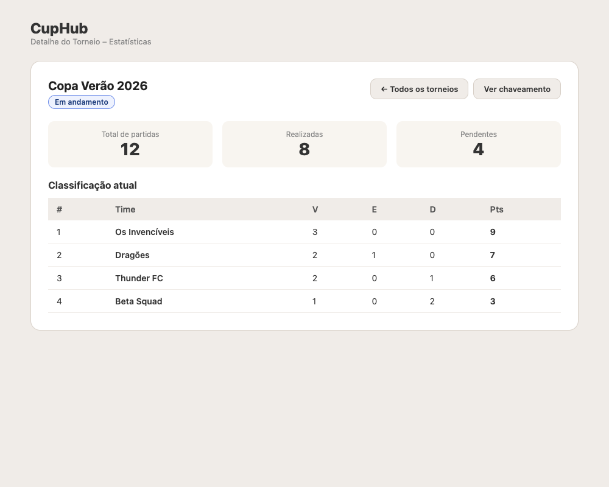
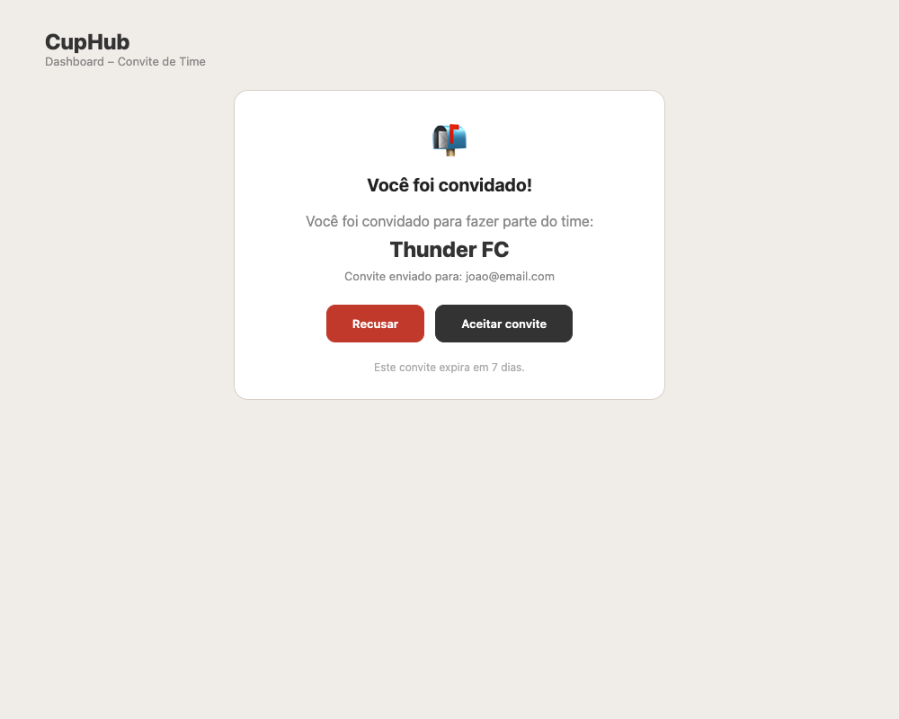

### 3.3.6 Processo 6 – Acompanhamento e Exibição de Estatísticas e Desempenho

O processo de acompanhamento e exibição de estatísticas ocorre dentro da plataforma e é conduzido tanto pelo **Organizador** quanto pelo **Participante** através do **Dashboard** (`/dashboard`), que é a tela inicial após o login.

O processo tem início quando o usuário realiza o login e é redirecionado para o Dashboard. O sistema carrega simultaneamente os torneios ativos (status `registration_open` ou `in_progress`) e os times do usuário (via `GET /api/teams/mine`), exibindo um resumo personalizado da atividade.

A partir do Dashboard, o usuário pode navegar para o **detalhe de um torneio** (`/torneios/:id`), onde visualiza a classificação atual, o número de partidas realizadas e pendentes, e os times inscritos. O Participante que recebeu um **convite de time** por e-mail pode acessar a página `/convite?token=...` para aceitar ou recusar o convite sem precisar navegar pelo sistema.

**Dashboard (Usuário logado)**

| **Campo**              | **Tipo**       | **Restrições** | **Valor default**                       |
| ---------------------- | -------------- | -------------- | --------------------------------------- |
| Meus times             | Cards          | Somente leitura | Times que o usuário integra (máx. 4)  |
| Torneios ativos        | Cards          | Somente leitura | Torneios com status ativo (máx. 6)    |
| Contadores (resumo)    | Números        | Somente leitura | Totais calculados em tempo real       |

| **Comandos**      | **Destino**              | **Tipo** |
| ----------------- | ------------------------ | -------- |
| Ver detalhes (torneio) | Detalhe do torneio  | default  |
| Ver detalhes (time)    | Detalhe do time     | default  |
| Ver todos (torneios)   | Lista de torneios   | default  |
| Ver todos (times)      | Lista de times      | default  |
| Criar time             | Criar novo time     | default  |

---

**Detalhe do torneio (Usuário)**

| **Campo**           | **Tipo**       | **Restrições** | **Valor default**         |
| ------------------- | -------------- | -------------- | ------------------------- |
| Nome e status       | Texto / Badge  | Somente leitura | Dado do banco            |
| Datas e nº de times | Texto          | Somente leitura | Dado do banco            |
| Partidas realizadas | Número         | Somente leitura | Contagem automática      |
| Partidas pendentes  | Número         | Somente leitura | Contagem automática      |
| Times inscritos     | Lista          | Somente leitura | Inscrições do torneio    |

| **Comandos**       | **Destino**     | **Tipo** |
| ------------------ | --------------- | -------- |
| Ver chaveamento    | Bracket         | default  |
| Inscrever time     | Enviar inscrição| default  |
| ← Todos torneios   | Lista de torneios | cancel |

---

**Aceite de convite (/convite?token=...)**

| **Campo**         | **Tipo** | **Restrições**  | **Valor default**      |
| ----------------- | -------- | --------------- | ---------------------- |
| Nome do time      | Texto    | Somente leitura | Dado do banco          |
| E-mail convidado  | Texto    | Somente leitura | Dado do banco          |
| Status do convite | Texto    | Somente leitura | pending / accepted / rejected |
| Expiração         | Texto    | Somente leitura | 7 dias após envio      |

| **Comandos**     | **Destino**       | **Tipo** |
| ---------------- | ----------------- | -------- |
| Aceitar convite  | Entrar no time    | default  |
| Recusar          | Rejeitar convite  | cancel   |

---

#### Wireframes

| # | Tela | Descrição |
|---|------|-----------|
| 1 |  | **Dashboard (Usuário):** Painel inicial pós-login com contadores resumo, cards de "Meus times" e "Torneios ativos", com links para detalhes e criação. |
| 2 |  | **Detalhe do Torneio:** Métricas de partidas (total, realizadas, pendentes), classificação atual com pontuação e links para o chaveamento. |
| 3 |  | **Aceite de Convite:** Página `/convite?token=...` acessada pelo link recebido no e-mail, exibindo o nome do time e botões para aceitar ou recusar o convite. |
