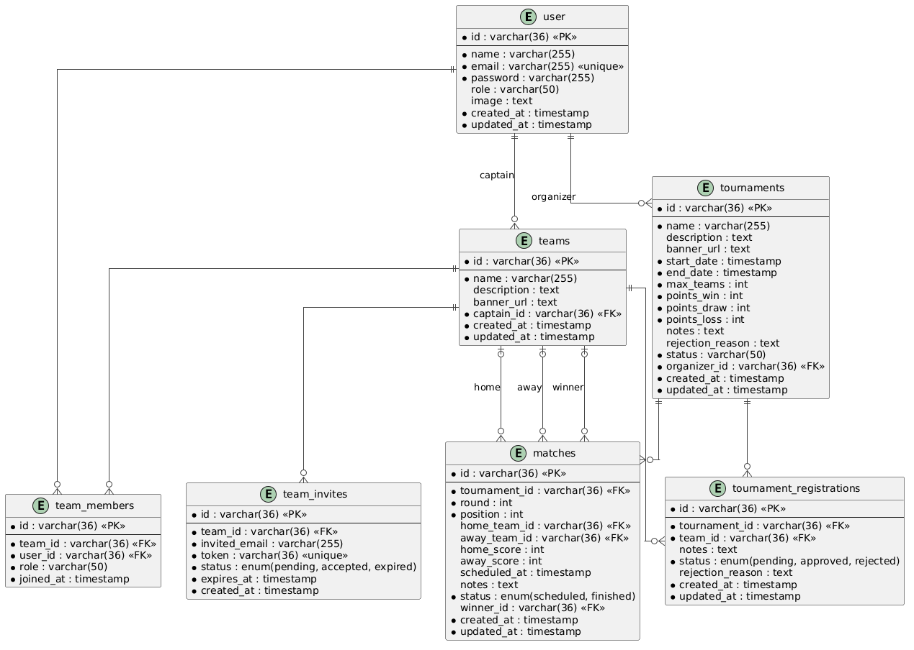

## 4. Projeto da solução

### 4.1. Modelo de dados

O modelo de dados do CupHub é composto por sete entidades principais, descritas a seguir com seus campos, tipos e relacionamentos.

---

#### User

Representa um usuário cadastrado na plataforma. Pode atuar como participante, organizador de torneios ou administrador.

| Campo | Tipo | Restrições |
|-------|------|-----------|
| id | VARCHAR(36) | PK, UUID gerado automaticamente |
| name | VARCHAR(255) | NOT NULL |
| email | VARCHAR(255) | NOT NULL, UNIQUE |
| password | VARCHAR(255) | NOT NULL (hash bcrypt) |
| role | VARCHAR(50) | NOT NULL, padrão `participant` (`participant`, `organizer`, `admin`) |
| image | TEXT | nullable |
| created_at | DATETIME | NOT NULL, preenchido automaticamente |
| updated_at | DATETIME | NOT NULL, atualizado automaticamente |

---

#### Team

Representa um time criado por um usuário (capitão). Um time pode se inscrever em torneios e ter membros convidados.

| Campo | Tipo | Restrições |
|-------|------|-----------|
| id | VARCHAR(36) | PK, UUID gerado automaticamente |
| name | VARCHAR(255) | NOT NULL |
| description | TEXT | nullable |
| banner_url | TEXT | nullable |
| captain_id | VARCHAR(36) | FK → users.id, NOT NULL |
| created_at | DATETIME | NOT NULL |
| updated_at | DATETIME | NOT NULL |

**Relacionamentos:** N:1 com `User` (capitão); 1:N com `TeamMember`; 1:N com `TeamInvite`; 1:N com `TournamentRegistration`.

---

#### TeamMember

Representa a associação de um usuário a um time. Registra o papel do membro dentro do time.

| Campo | Tipo | Restrições |
|-------|------|-----------|
| id | VARCHAR(36) | PK, UUID gerado automaticamente |
| team_id | VARCHAR(36) | FK → teams.id, NOT NULL |
| user_id | VARCHAR(36) | FK → users.id, NOT NULL |
| role | VARCHAR(50) | NOT NULL, padrão `member` |
| joined_at | DATETIME | NOT NULL, preenchido automaticamente |

**Relacionamentos:** N:1 com `Team`; N:1 com `User`.

---

#### TeamInvite

Representa um convite enviado por e-mail para um usuário se juntar a um time. O convite tem validade de 7 dias e é identificado por um token único.

| Campo | Tipo | Restrições |
|-------|------|-----------|
| id | VARCHAR(36) | PK, UUID gerado automaticamente |
| team_id | VARCHAR(36) | FK → teams.id, NOT NULL |
| invited_email | VARCHAR(255) | NOT NULL |
| token | VARCHAR(36) | NOT NULL, UNIQUE, UUID gerado automaticamente |
| status | VARCHAR(50) | NOT NULL, padrão `pending` (`pending`, `accepted`, `expired`) |
| expires_at | DATETIME | NOT NULL, padrão: 7 dias após criação |
| created_at | DATETIME | NOT NULL |

**Relacionamentos:** N:1 com `Team`.

---

#### Tournament

Representa um torneio criado por um organizador. Passa por um fluxo de aprovação antes de aceitar inscrições.

| Campo | Tipo | Restrições |
|-------|------|-----------|
| id | VARCHAR(36) | PK, UUID gerado automaticamente |
| name | VARCHAR(255) | NOT NULL |
| description | TEXT | nullable |
| banner_url | TEXT | nullable |
| start_date | DATETIME | NOT NULL |
| end_date | DATETIME | NOT NULL |
| max_teams | INT | NOT NULL, padrão `8` |
| points_win | INT | NOT NULL, padrão `3` |
| points_draw | INT | NOT NULL, padrão `1` |
| points_loss | INT | NOT NULL, padrão `0` |
| notes | TEXT | nullable |
| rejection_reason | TEXT | nullable |
| status | VARCHAR(50) | NOT NULL, padrão `draft` (`draft`, `pending`, `approved`, `rejected`, `active`, `finished`) |
| organizer_id | VARCHAR(36) | FK → users.id, NOT NULL |
| created_at | DATETIME | NOT NULL |
| updated_at | DATETIME | NOT NULL |

**Relacionamentos:** N:1 com `User` (organizador); 1:N com `TournamentRegistration`; 1:N com `Match`.

---

#### TournamentRegistration

Representa a inscrição de um time em um torneio. Passa por revisão do organizador antes de ser aprovada.

| Campo | Tipo | Restrições |
|-------|------|-----------|
| id | VARCHAR(36) | PK, UUID gerado automaticamente |
| tournament_id | VARCHAR(36) | FK → tournaments.id, NOT NULL |
| team_id | VARCHAR(36) | FK → teams.id, NOT NULL |
| notes | TEXT | nullable |
| status | VARCHAR(50) | NOT NULL, padrão `pending` (`pending`, `approved`, `rejected`) |
| rejection_reason | TEXT | nullable |
| created_at | DATETIME | NOT NULL |
| updated_at | DATETIME | NOT NULL |

**Relacionamentos:** N:1 com `Tournament`; N:1 com `Team`.

---

#### Match

Representa uma partida dentro de um torneio, posicionada em uma rodada e posição do chaveamento.

| Campo | Tipo | Restrições |
|-------|------|-----------|
| id | VARCHAR(36) | PK, UUID gerado automaticamente |
| tournament_id | VARCHAR(36) | FK → tournaments.id, NOT NULL |
| round | INT | NOT NULL |
| position | INT | NOT NULL |
| home_team_id | VARCHAR(36) | FK → teams.id, nullable |
| away_team_id | VARCHAR(36) | FK → teams.id, nullable |
| home_score | INT | nullable |
| away_score | INT | nullable |
| scheduled_at | DATETIME | nullable |
| notes | TEXT | nullable |
| status | VARCHAR(50) | NOT NULL, padrão `scheduled` (`scheduled`, `finished`) |
| winner_id | VARCHAR(36) | FK → teams.id, nullable |
| created_at | DATETIME | NOT NULL |
| updated_at | DATETIME | NOT NULL |

**Relacionamentos:** N:1 com `Tournament`; N:1 com `Team` (home, away e winner).

### 4.2. Tecnologias

| **Dimensão**        | **Tecnologia**       | **Papel**                                                                 |
| ------------------- | -------------------- | ------------------------------------------------------------------------- |
| Front end           | React com Vite       | Construção da interface do usuário com roteamento e reatividade            |
| UI/Componentes      | shadcn/ui            | Biblioteca de componentes acessíveis baseados em Radix UI e Tailwind CSS   |
| Comunicação com API | React Query          | Gerenciamento de requisições assíncronas, cache e sincronização com a API  |
| Back end            | Java com Spring Boot | API REST, implementação das regras de negócio e autenticação via JWT       |
| Persistência        | JPA + Hibernate      | Mapeamento objeto-relacional (ORM) e abstração do acesso ao banco de dados |
| SGBD                | MySQL ou PostgreSQL  | Armazenamento relacional e persistência dos dados da aplicação             |
| Documentação API    | Swagger / OpenAPI    | Geração de documentação interativa dos endpoints REST                      |
| Versionamento       | GitHub               | Controle de versão do código e colaboração entre membros da equipe         |
| Build/Execução      | Maven ou Gradle      | Gerenciamento de dependências e automação do build do projeto backend      |
